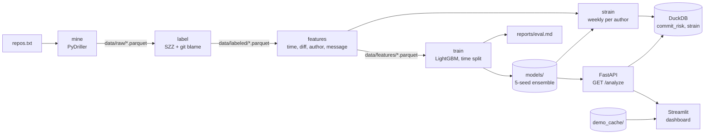

# CommitRad

CommitRad predicts **which commits are likely to introduce bugs** and surfaces **weekly
developer-strain signals** from nothing but git history. It mines commits, labels
bug-introducing ones with SZZ, builds leak-free features, trains a LightGBM model on a
strictly time-based split, explains every prediction with SHAP, and serves it all through
a FastAPI endpoint and a Streamlit dashboard.

> **Strain scores are signals, not judgments about people.** They are derived from commit
> metadata and can reflect deadlines, time zones or personal schedules. Never use them to
> evaluate, rank or discipline anyone.

## Quick start

Requires Python 3.11, [uv](https://docs.astral.sh/uv/) and git.

```bash
make setup        # uv sync: install pinned dependencies
make dashboard    # http://localhost:8501, demo repos load instantly
```

The repo ships a trained model (`models/`) and pre-computed snapshots of three popular
repos (`demo_cache/`: pallets/flask, psf/requests, pallets/click), so the dashboard works
immediately: pick a demo repo, or paste any public GitHub, GitLab or Codeberg URL to analyze
it live. The dark, code-tool theme lives in `.streamlit/config.toml` and `src/commitrad/ui.py`
(design tokens, CSS and HTML components), with Inter and JetBrains Mono bundled under
`src/commitrad/static/fonts` (SIL OFL) so it renders offline. Streamlit reads the config from
the folder it is launched in, so start the dashboard from the project root.

```bash
make serve        # API on http://localhost:8000 (docs at /docs)
curl "http://localhost:8000/analyze?repo=https://github.com/pallets/click&limit=5"
```

With Docker:

```bash
docker build -t commitrad .
docker run -p 8501:8501 commitrad                                      # dashboard
docker run -p 8000:8000 commitrad commitrad serve --host 0.0.0.0       # API
```

## Architecture



| Stage | Command | Module | Output |
|---|---|---|---|
| Mine | `commitrad mine repos.txt` | `mining.py` | one Parquet per repo: hash, author, UTC time + tz offset, message, line/file counts, paths |
| Label | `commitrad label repos.txt` | `szz.py` | `is_fix`, `is_bug_introducing`, `fixed_by`, `bug_found_at` |
| Features | `commitrad features repos.txt` | `features.py` | 17 features per non-merge commit |
| Train | `commitrad train` | `model.py`, `report.py` | `models/`, `reports/eval.md` |
| Strain | `commitrad strain` | `strain.py`, `store.py` | DuckDB tables `strain(author, week, strain, …)` and `commit_risk` |
| Serve | `commitrad serve` | `api.py`, `analyze.py` | `GET /analyze?repo=URL`, `GET /health` |
| Dashboard | `commitrad dashboard` | `dashboard.py` | strain heatmap, per-author radar + weekly trend, sliding top-5 risky-commit carousel |

`make demo` runs the whole offline pipeline (mine → label → features → train → strain) on
the five repos in `repos.txt`. Mining and labeling run in parallel and are resumable:
finished repos are skipped, and writes are atomic, so an interrupted run never leaves a
file that looks complete.

### How the pieces work

**SZZ labels.** A fix commit is a non-merge, non-bot commit whose message matches
`fix`, `bug`, `patch` or `issue #N`, excluding style/docs/typo "fixes". For each fix,
CommitRad takes the source lines it removed (`git diff -U0 -w`, so whitespace-only changes
vanish), drops blank and comment-only lines, and runs `git blame -w` on the fix's parent.
The blamed commits are bug-introducing. `bug_found_at` records when the first such fix
landed.

**Features, without leakage.** Author-local hour, weekday, night (22:00-06:00), weekend,
hours since the author's previous commit; lines added/deleted, files touched, prior churn
of touched files; the author's prior commits, 30-day commit rate and past bug rate;
message length, word count, vagueness and sentiment. Every history-based feature uses only
commits with a **strictly earlier** timestamp, and a past commit counts as buggy only once
its fix has landed (`bug_found_at < t`). The label column is never read.
`tests/test_leakage.py` proves this: recomputing any commit's features from only the data
available at that moment gives identical values, and scrambling everything in the future
changes nothing. Both tests were checked by injecting leaks and confirming they fail.

**Model.** All repos are pooled and ordered by time: oldest 70% train, next 15%
validation, last 15% test, using timestamp cutoffs (never a random split). By default,
train and validation labels only count fixes that landed before the next split begins
(`--labels strict`). Class imbalance is handled with `scale_pos_weight`; five seeds are
averaged in log-odds with early stopping on validation ROC-AUC. SHAP values are exact
TreeSHAP from LightGBM's `pred_contrib`.

**Strain.** For each author and author-local ISO week, a weighted mean of four components
in [0, 1]: off-hours share, mean risk percentile, burstiness of inter-commit gaps
(Kim & Jo 2016 finite-size correction) and message negativity. Weights live in
[`config/strain.toml`](config/strain.toml). Bot accounts are excluded.

**API.** `GET /analyze?repo=URL` accepts only `https://` URLs on github.com, gitlab.com or
codeberg.org shaped `/<owner>/<repo>` (no credentials, ports or queries), and returns 422
otherwise. Clones are cached and fast-forwarded; results are cached per (repo, HEAD).
The request deadline (default 120 s) returns 504 while the work finishes in the
background, so a retry hits the cache. Oversized repos return 413, unreachable ones 502.
The response lists every commit with its risk, risk percentile and top-3 SHAP reasons in
plain English, plus weekly strain per author, a disclaimer, and `in_training_data`
(true when scores are in-sample).

## Results

From [`reports/eval.md`](reports/eval.md), 5 repos (tenacity, itsdangerous, markupsafe,
colorama, humanize), 2,578 non-merge commits, 11.2% labeled bug-introducing by SZZ.

| Test period (2024-09 → 2026-11, 387 commits, 24 positives) | PR-AUC [95% CI] | ROC-AUC [95% CI] |
|---|---|---|
| **LightGBM ensemble** | **0.221** [0.098, 0.371] | **0.765** [0.673, 0.843] |
| Diff-size heuristic | 0.130 [0.078, 0.245] | 0.726 [0.626, 0.810] |
| Random | 0.062 | 0.500 |

The model ranks risky commits at 3.6× the random baseline. The strongest drivers by mean
\|SHAP\| are lines added, the author's prior commits in the repo (fewer → riskier), hour of
day, files touched and prior churn of the touched files. Trained on final instead of
strict labels, the same pipeline scores test PR-AUC 0.190.

## Known limits

- **SZZ labels are noisy.** Fixes that only add lines cannot be blamed; refactors, test
  fixes and moved code get blamed anyway; keyword matching misses fixes with unusual
  messages. The model learns agreement with SZZ, not ground-truth bugs.
- **Recent commits are under-labeled.** Bugs in the test period may not be fixed yet, so
  some test negatives are undiscovered positives. Metrics are likely pessimistic for
  recall and noisy overall.
- **Small evaluation set.** 24 test positives give wide intervals: the model's lead over
  the diff-size heuristic is suggestive, not significant. The validation period has only
  11 positives, so early stopping is noisy. The test set was scored three times during
  development (see the report).
- **Risk scores are for ranking.** Class weighting inflates them, scores saturate near
  0.51, and many commits tie in the top percentile.
- **Newcomer effect.** "Author's first commit in this repo" is one of the strongest risk
  drivers, so the top risky commits are often from first-time contributors. That is a
  real statistical pattern, but showing it in a team setting could stigmatize newcomers.
  Treat it as a prompt for careful review, not a verdict.
- **Strain is a proxy.** It sees only commit timestamps and messages, not meetings,
  reviews, on-call, time off or work outside git. Off-hours may simply be someone's normal
  hours. Burstiness carries signal only in weeks with 3+ commits (about 20% of
  author-weeks), and negativity is near zero with the built-in lexicon, so in practice
  strain mostly reflects off-hours share and commit risk.
- **Sentiment defaults to a lexicon.** Install the optional HuggingFace model with
  `uv sync --extra sentiment` (DistilBERT SST-2, which is not tuned for commit messages).
- **Limited transfer.** Trained on five small Python libraries; expect weaker results on
  other languages, monorepos or very different workflows.

## Development

```bash
make test         # pytest (131 tests: pipeline, SZZ fixtures, leakage, API, dashboard)
make lint         # ruff check + ruff format --check
make format
make precache     # rebuild demo_cache/ snapshots
make docker
```

CI (GitHub Actions) runs lint, format check and tests on every push and pull request, and
builds the Docker image.

```
src/commitrad/
  cli.py            commitrad <command>
  repos.py          repo list, slugs, clone cache
  mining.py         PyDriller -> Parquet
  szz.py            fix detection, blame, labels
  features.py       leak-free features
  sentiment.py      lexicon / optional HuggingFace
  metrics.py        PR-AUC, ROC-AUC, bootstrap CIs
  model.py          time split, LightGBM ensemble, SHAP
  report.py         reports/eval.md
  strain.py         weekly strain score
  store.py          DuckDB tables
  pipeline.py       score + strain + persist
  explain.py        SHAP -> plain English
  analyze.py        single-repo pipeline, validation, caching
  api.py            FastAPI app
  dashboard.py      Streamlit app
  dashboard_data.py chart data shaping
  ui.py             design tokens, CSS, HTML components
```

Dependencies: PyDriller, pyarrow, pandas, LightGBM, DuckDB, FastAPI, uvicorn, Streamlit
(runtime); pytest, ruff, httpx (dev). Charts use Altair, which ships with Streamlit.
