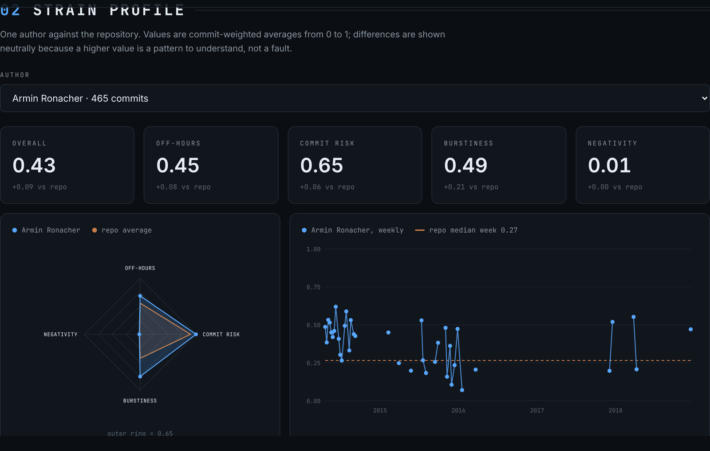
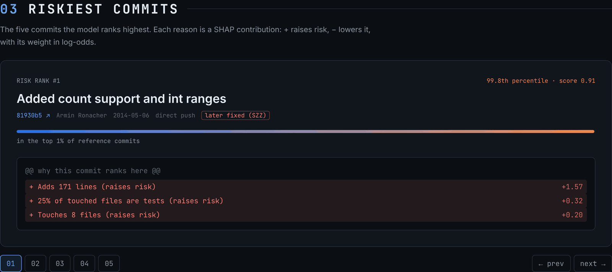
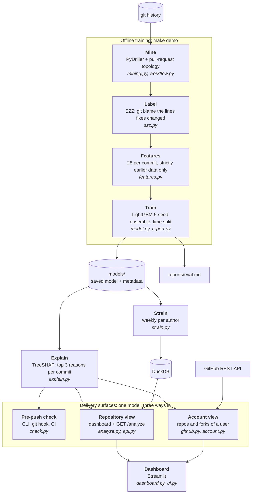
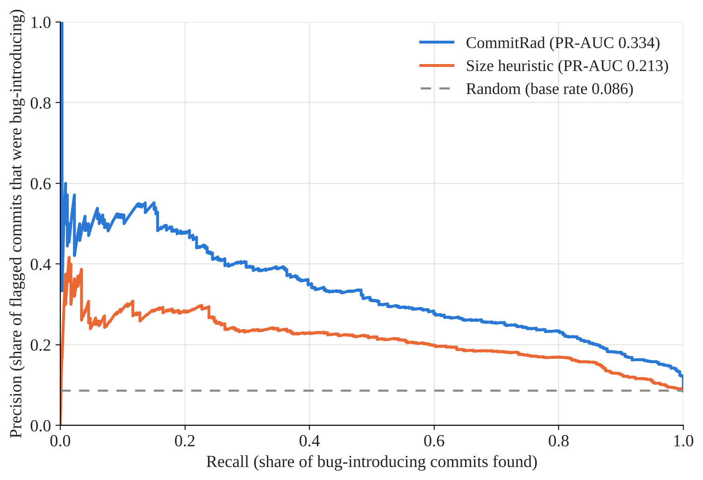
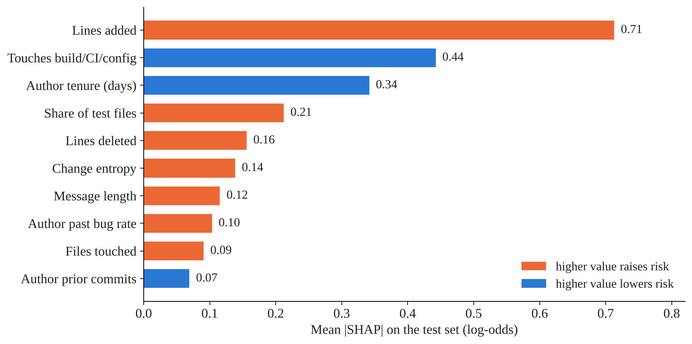

<div align="center">


# CommitRad

**An early-warning radar for code changes.**<br>
Scores every commit, including the ones you haven't pushed yet, for the risk that it will need a
bug fix, and tells you *why*.

[](https://github.com/Iamshi-vissa/CommitRad/actions/workflows/ci.yml)


[Quick start](#quick-start) · [Dashboard](#the-dashboard) · [Architecture](#architecture) ·
[How it works](#how-it-works) · [Results](#results) · [Limits](#known-limits)


</div>

> **Signals, not judgments.** Risk and strain scores come from commit metadata. They can reflect
> deadlines, time zones or personal schedules, and must never be used to evaluate, rank or
> discipline anyone.

## Why CommitRad

- **Review attention is the bottleneck.** Most commits are fine; a few cause most of the bugs, and
  they look just like the safe ones.
- **The warning signs are already in git history**: big changes scattered across many files,
  unfamiliar code, files many people have touched, work landed without a pull request.
- **Existing tools look at the wrong moment.** Dashboards report problems after they ship, as team
  metrics for managers. CommitRad scores each change for the developer, *before* the push.

| Where | What you get |
|---|---|
| **Before you push**: `commitrad check`, git pre-push hook, CI step | Your unpushed commits, riskiest first, each with its top 3 reasons. Warn-only by default; optionally block the top 1%. |
| **Any repository**: dashboard or `GET /analyze` | Every commit scored and explained, the five riskiest in a carousel, and weekly strain per contributor. |
| **Your GitHub account**: username (+ optional token) | Your commits across all your repos and forks: risk, later-fix rate vs each repo's norm, pull-request share, off-hours share, push rhythm, fork drift. |

## Quick start

Requires [uv](https://docs.astral.sh/uv/) and git (uv installs Python 3.11 for you).

```bash
git clone https://github.com/Iamshi-vissa/CommitRad.git
cd CommitRad
uv sync                        # or: make setup
uv run commitrad dashboard     # or: make dashboard  ->  http://localhost:8501
```

Paste `https://github.com/pallets/click` and press Enter. Click, requests and flask are
pre-computed and were never used for training, so they open instantly and show genuine predictions.

> **Windows:** if C: is full, use `uv sync --cache-dir D:\uv-cache --link-mode copy`. Always launch
> from the project folder so the theme in `.streamlit/config.toml` is found.

**Check your commits before pushing**

```bash
uv run commitrad check --repo .                              # score commits in <upstream>..HEAD
uv run commitrad hook install --repo .                       # run on every git push (warn only)
uv run commitrad hook install --repo . --block-above 0.99    # block pushes in the top 1%
```


**React UI** (needs [Node.js](https://nodejs.org/) 18+): the same three views as a React app, with
the [React Bits](https://reactbits.dev) GradientWaves background. Build it once; the API then serves
it at `/`.

```bash
cd web
npm install
npm run build
cd ..
uv run commitrad serve         # UI at http://localhost:8000, API at /analyze and /account
```

For live editing, keep `uv run commitrad serve` running and start `npm run dev` in `web/`
(http://localhost:5173, API calls are proxied to port 8000).

**API:** `uv run commitrad serve`, then
`GET http://localhost:8000/analyze?repo=https://github.com/pallets/click` (docs at `/docs`). `GET /account?user=<login>&repos=6` analyzes a GitHub account; pass a token in the
`X-GitHub-Token` header.

**Docker:** `docker build -t commitrad .`, then `docker run -p 8501:8501 commitrad` for the
dashboard or `docker run -p 8000:8000 commitrad commitrad serve --host 0.0.0.0` for the API.

## The dashboard

Three views in a dark code-tool UI (Inter and JetBrains Mono are bundled, so it renders offline).
Every slider and selector changes only what is displayed, never a score.

| Strain profile | Riskiest commits |
|---|---|
|  |  |
| One author against the repo: off-hours, commit risk, burstiness and negativity, plus the weekly trend. | The five riskiest commits as a carousel. Reasons read like a diff: `+` raises risk, `−` lowers it. |

- **Repository:** paste a public GitHub, GitLab or Codeberg URL. Number tiles, weekly strain
  heatmap, strain profile and riskiest commits.
- **GitHub account:** enter a username, plus a token for private repos and a higher rate limit. The
  token stays in session memory and is sent only to github.com. A read-only fine-grained token
  (Contents + Metadata) is enough.
- **Pre-push check:** copy-ready commands for the hook and CI.

## Architecture



| Stage | Command | Module |
|---|---|---|
| Mine commits and how each landed (PR merge, squash `(#N)`, direct push) | `commitrad mine repos.txt` | `mining.py`, `workflow.py` |
| Label bug-introducing commits | `commitrad label repos.txt` | `szz.py` |
| Build the 28 features | `commitrad features repos.txt` | `features.py` |
| Train and evaluate | `commitrad train` | `model.py`, `report.py` |
| Weekly strain into DuckDB | `commitrad strain` | `strain.py`, `store.py` |
| Pre-push check / hook | `commitrad check`, `commitrad hook install` | `check.py` |
| API | `commitrad serve` | `api.py`, `analyze.py` |
| Dashboard | `commitrad dashboard` | `dashboard.py`, `dashboard_data.py`, `ui.py` |

`make demo` rebuilds everything from scratch: mine, label, features, train, strain.

## How it works

**1. Labels (SZZ).** A fix commit is a non-merge, non-bot commit whose message mentions fix, bug,
patch or issue #N (typo, docs and style fixes excluded). The source lines it removed or changed are
traced with `git blame` to the commit that wrote them, which is labeled bug-introducing.
Whitespace-only and comment-only lines are ignored.

**2. Features (28, all leak-free).**

| Group | Features |
|---|---|
| Size and diffusion | lines added / deleted, files touched, top-level directories touched, change entropy |
| File history | prior churn of touched files (max, mean), distinct earlier authors, mean days since last change |
| How it landed | via pull request, PR size, share of test files, touches build/CI/config, revert, co-authored |
| Author | prior commits, tenure, 30-day commit rate, past bug rate (only bugs already fixed) |
| Time | local hour, weekday, night, weekend, hours since the author's previous commit |
| Message | length, word count, vagueness, sentiment |

History features use only commits with a strictly earlier timestamp. `tests/test_leakage.py`
recomputes every feature from only the data available at that moment and requires identical
values; scrambling all future data must change nothing.

**3. Model.** LightGBM gradient-boosted trees (15 leaves, learning rate 0.03, early stopping on
validation ROC-AUC), class-weighted 4.5× for the rare bug-introducing class, averaged over 5
random seeds. No random splits anywhere: oldest 70% of history trains, next 15% validates, newest
15% tests.

**4. Explanations.** Exact TreeSHAP splits each score into per-feature contributions; the three
largest become plain-language reasons such as "adds 777 lines (raises risk)".

**5. Strain.** Per author and week: off-hours share (0.30), mean commit risk (0.30), burstiness
(0.20, Kim & Jo 2016) and message negativity (0.20). Weights live in `config/strain.toml`.

## Results

Trained on **16 repositories in 4 languages**: 27,384 non-merge commits, 18.2% labeled
bug-introducing.

<details>
<summary>Training repositories</summary>

| Language | Repositories |
|---|---|
| Python | tenacity, itsdangerous, markupsafe, colorama, humanize, httpx, attrs, structlog, jinja, rich |
| JavaScript | express, commander.js, axios |
| Go | cobra, gin |
| Rust | ripgrep |

</details>

**Test period** (Nov 2023 – Nov 2026, 4,108 commits, 352 bug-introducing):

| | PR-AUC [95% CI] | ROC-AUC [95% CI] | Precision in top 10% |
|---|---|---|---|
| **CommitRad** | **0.334** [0.293, 0.385] | **0.849** [0.831, 0.867] | **0.345** |
| "Bigger diffs are riskier" | 0.213 [0.184, 0.253] | 0.764 [0.738, 0.786] | 0.241 |
| Random | 0.086 | 0.500 | 0.086 |

**Unseen repositories** (never used in training):

| Repository | Commits | PR-AUC | ROC-AUC | Lift in top 10% |
|---|---|---|---|---|
| pallets/click | 2,172 | 0.428 | 0.816 | 3.6× |
| psf/requests | 4,884 | 0.347 | 0.797 | 3.1× |
| pallets/flask | 3,832 | 0.387 | 0.829 | 4.1× |

| Precision-recall on the test period | What drives risk (mean \|SHAP\|) |
|---|---|
|  |  |

Full report: [`reports/eval.md`](reports/eval.md).

## How it differs

| | GitHub Insights | Team metrics (LinearB, Swarmia) | Static analysis (SonarQube) | CodeScene | **CommitRad** |
|---|---|---|---|---|---|
| Predicts which change will need a fix | no | no | no | indirectly | **yes** |
| Explains each prediction | – | – | per rule | per file | **per commit (SHAP)** |
| Works before you push | no | no | yes | no | **yes** |
| Your view across all your repos and forks | counts only | org level | no | org level | **yes** |
| Runs locally, code never leaves your machine | n/a | SaaS | self-host | SaaS / on-prem | **yes** |

## Known limits

- **SZZ labels are noisy.** Fixes that only add lines can't be traced, and refactors and test
  fixes get blamed anyway. The model learns agreement with SZZ, not ground truth.
- **Recent commits are under-labeled.** Bugs from the last few months may not be fixed yet.
- **Pre-push scores lean high.** Pull-request status is only known at merge, so an unpushed commit
  reads as a direct push.
- **Account coverage depends on email.** Commits made with an email not linked to the GitHub
  account are missed. Push activity covers GitHub's last 90 days, in UTC. Without a token the API
  allows 60 requests per hour.
- **Newcomer effect.** New authors rank riskier. Give their first changes a careful, friendly
  review, never discouragement.
- **Strain is a proxy.** It sees commit times and messages only, not meetings, leave or schedules.

## Project layout

```
src/commitrad/     pipeline, model, API, dashboard (one module per stage)
web/               React UI (Vite, TypeScript, Tailwind, React Bits)
tests/             169 tests, including the leakage test
config/            strain weights (strain.toml)
models/            trained model + metadata
reports/eval.md    full evaluation report
demo_cache/        pre-computed click, requests, flask
repos.txt          training repositories
```

## Development

```bash
make test      # pytest (169 tests)
make lint      # ruff check + ruff format --check
make precache  # rebuild demo_cache/ snapshots
make ui        # build the React UI and serve it with the API
make docker    # build the image (includes the React UI)
```

CI runs lint, format check and tests on every push and pull request, and builds the Docker image.
