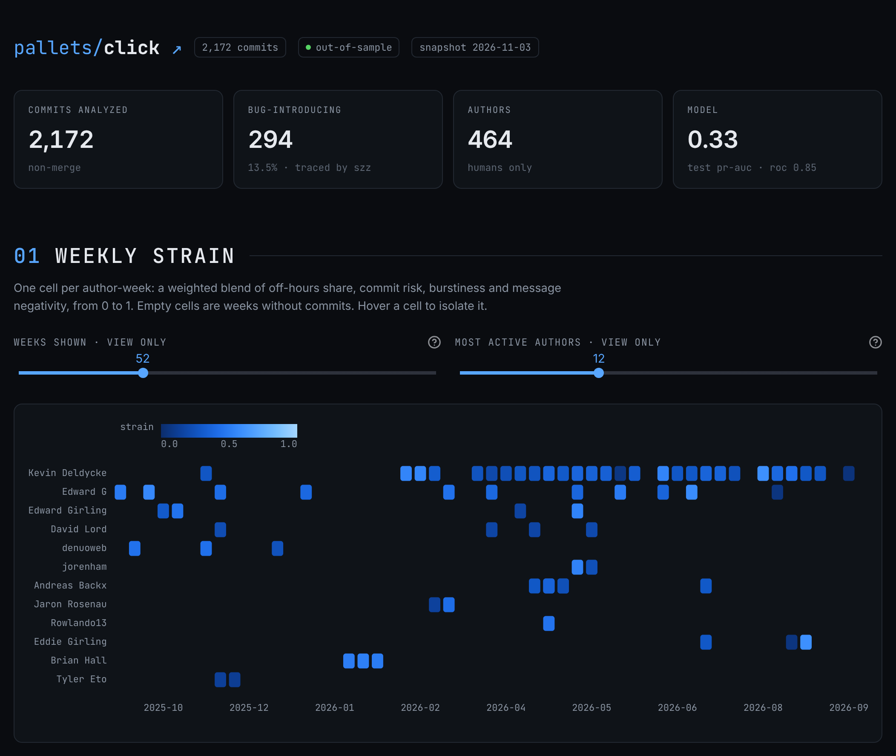
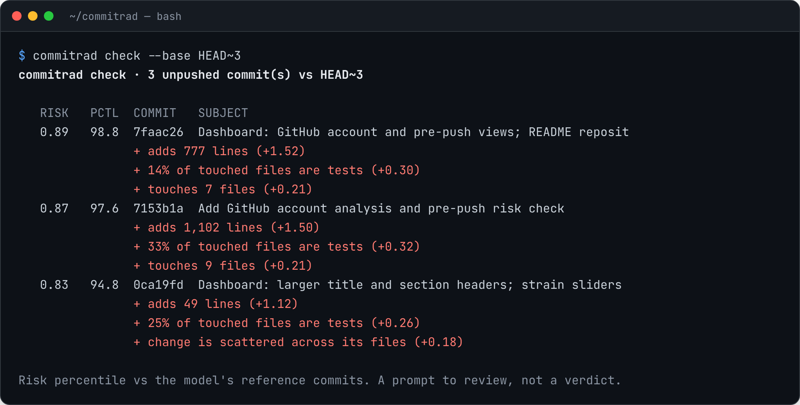

<div align="center">


# CommitRad

Warns you which commits are likely to need a bug fix, before you push them, and tells you why.

[](https://github.com/Iamshi-vissa/CommitRad/actions/workflows/ci.yml)




</div>

## About

Most commits are fine. A few cause most of the bugs, and they usually look just like the safe ones.
CommitRad reads a project's git history, learns what risky changes tend to look like, and gives
every commit a risk score with its top three reasons, such as "touches 14 files" or "this file
changes very often".

It runs on your own machine, so your code never leaves it. You can use it from the terminal before
you push, from a git hook, in CI, or through a small web app.

> Scores come from commit metadata only. They can reflect deadlines, time zones or personal
> schedules, so please never use them to judge or rank people.

## Features

- **Pre-push check:** scores your unpushed commits, riskiest first, with reasons
- **Git hook and CI step:** warns on every push, and can optionally block the riskiest 1%
- **Repository view:** paste any public GitHub, GitLab or Codeberg URL to see every commit scored,
  the five riskiest, and a weekly "strain" heatmap per contributor
- **Account view:** enter a GitHub username to see your commits across all your repos and forks
- **REST API** with interactive docs at `/docs`

## How it works

1. **Find past bugs.** It looks for commits that fixed something, then uses `git blame` to find the
   earlier commit that wrote the broken lines. Those become the "risky" examples.
2. **Describe each commit.** It measures 28 things about every commit: how big it is, how many files
   and folders it touches, how often those files change, how it was merged, who wrote it and when.
   Only information that existed at the time of the commit is used.
3. **Train a model.** A LightGBM model learns from about 27,000 commits across 16 open-source
   projects in Python, JavaScript, Go and Rust.
4. **Explain the score.** For each commit, the three factors that pushed its score up or down the
   most are turned into plain sentences.

On projects it has never seen, the riskiest 10% of commits it flags contain 3 to 4 times more
bug-introducing commits than a random 10%. Full numbers and charts are in
[docs/DETAILS.md](docs/DETAILS.md) and [reports/eval.md](reports/eval.md).

## Tech stack

- **Core:** Python 3.11, PyDriller, pandas, LightGBM, SHAP, DuckDB
- **API:** FastAPI
- **Web app:** React, TypeScript, Vite, Tailwind CSS
- **Tooling:** uv, pytest, ruff, Docker

## Getting started

You need [uv](https://docs.astral.sh/uv/) (it installs Python 3.11 for you), git and
[Node.js](https://nodejs.org/) 18+.

```bash
git clone https://github.com/Iamshi-vissa/CommitRad.git
cd CommitRad
uv sync
cd web && npm install && npm run build && cd ..
uv run commitrad serve
```

Open <http://localhost:8000> and paste `https://github.com/pallets/click`. Click, requests and flask
come pre-computed, so they open straight away.

With Docker instead:

```bash
docker build -t commitrad .
docker run -p 8000:8000 commitrad
```

On Windows, if your C: drive is full, use `uv sync --cache-dir D:\uv-cache --link-mode copy`.

## Usage

Check your own commits before pushing:

```bash
uv run commitrad check --repo .                             # score commits not pushed yet
uv run commitrad hook install --repo .                      # warn on every git push
uv run commitrad hook install --repo . --block-above 0.99   # block pushes in the riskiest 1%
```



Use the API:

```
GET /analyze?repo=https://github.com/pallets/click
GET /account?user=<github-login>&repos=6        (optional token in the X-GitHub-Token header)
```

Retrain everything from scratch with `make demo`.

## Running the tests

```bash
make test     # 146 tests, including one that checks no future data leaks into training
make lint     # ruff check and format check
```

## Project structure

```
src/commitrad/   pipeline, model and API, one module per step
web/             React web app
tests/           146 tests
config/          strain weights
models/          trained model
reports/         evaluation report
demo_cache/      pre-computed results for click, requests and flask
docs/            screenshots and the detailed write-up (DETAILS.md)
```

## Known limits

- The bug labels come from an automatic method (SZZ), so some are wrong. The model learns to agree
  with it, not with the truth.
- Recent commits look safer than they are, because their bugs may not have been found yet.
- Unpushed commits score a little high, since the tool can't know yet whether they'll go through a
  pull request.
- New contributors get higher scores. Give their first changes a careful, friendly review.
- The account view only finds commits made with an email linked to the GitHub account.

## Status

Complete. Training, scoring, the pre-push check, the API and the web app all work, and CI runs the
tests on every push.

## License

MIT. See [LICENSE](LICENSE).
