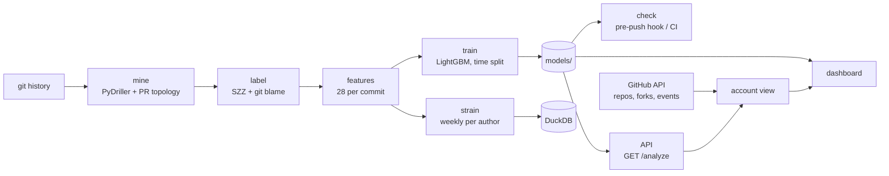

# CommitRad

**An early-warning radar for code changes, built for the developer.** CommitRad learns from a
repository's own history which kinds of commits later needed a bug fix, then scores new commits
(including the ones you have not pushed yet) and says *why* each one is risky. It also gives you
a private view of your own working patterns across all your GitHub repos and forks: the things
GitHub's contribution graph cannot show.

> **Signals, not judgments.** Risk and strain scores come from commit metadata. They can reflect
> deadlines, time zones or personal schedules, and must never be used to evaluate, rank or
> discipline anyone.

## The problem

- **Review attention is the bottleneck.** Most commits are fine; a few cause most of the bugs.
  Reviewers can't give every change the same scrutiny, so risky ones slip through looking just
  like the safe ones.
- **The warning signs are already in git history**, but nobody reads them: big changes scattered
  across many files, unfamiliar code, files many people have touched, work landed without a
  pull request, late-night bursts.
- **Existing tools look at the wrong moment or for the wrong audience.** Dashboards report
  problems after they ship, usually as team metrics for managers. GitHub shows *how much* you
  commit, never how your changes behave.

## The solution

CommitRad applies **just-in-time defect prediction** (a well-studied research technique, Kamei
et al. 2013) to your repositories, and puts it where it helps:

| Where | What you get |
|---|---|
| **Before you push**: `commitrad check`, git pre-push hook, CI step | Your unpushed commits, riskiest first, each with its top 3 reasons. Warn-only by default; optionally block the top 1%. |
| **Any repository**: dashboard or `GET /analyze` | Every commit scored and explained, the riskiest five in a carousel, and weekly strain per contributor. |
| **Your GitHub account**: username (+ optional token) | Your commits across all your repos and forks: risk, how often a later fix traced a bug back to you vs each repo's norm, share via pull requests, off-hours share, push rhythm by hour, fork drift vs upstream. |

### How it differs from existing tools

| | GitHub Insights | Team-metrics platforms (LinearB, Swarmia, Jellyfish) | Static analysis (SonarQube, linters) | Behavioral code analysis (CodeScene) | **CommitRad** |
|---|---|---|---|---|---|
| Unit of analysis | repo activity counts | team throughput, DORA | source code | files, hotspots | **each commit** |
| Predicts which change will need a fix | no | no | no (rule violations) | indirectly (hotspots) | **yes, learned from SZZ labels** |
| Explains each prediction | – | – | per rule | per file | **per commit, SHAP** |
| Before you push | no | no | yes (lint) | no | **yes, pre-push hook + CI** |
| Your own view across all your repos and forks | contribution graph only | org-level | no | org-level | **yes** |
| Fork drift, push rhythm by hour, PR vs direct pushes | partly, per repo | partly | no | no | **yes, in one place** |
| Runs locally, code never leaves your machine | n/a | SaaS | self-host option | SaaS / on-prem | **yes, offline-capable** |
| Who it's for | everyone | managers | everyone | tech leads | **the developer first** |

## Quick start

Requires Python 3.11, [uv](https://docs.astral.sh/uv/) and git.

```bash
make setup        # uv sync: install pinned dependencies
make dashboard    # http://localhost:8501
```

On Windows without `make`: `uv sync`, then `uv run commitrad dashboard`. If your C: drive is full,
add `--cache-dir D:\uv-cache` to uv commands.

**Check your commits before pushing:**

```bash
uv run commitrad check --repo .                          # score commits in <upstream>..HEAD
uv run commitrad hook install --repo .                   # run it on every git push (warn only)
uv run commitrad hook install --repo . --block-above 0.99   # block pushes in the top 1%
```

**API:** `make serve`, then `GET http://localhost:8000/analyze?repo=https://github.com/pallets/click`.

**Docker:** `docker build -t commitrad .`, then `docker run -p 8501:8501 commitrad` (dashboard) or
`docker run -p 8000:8000 commitrad commitrad serve --host 0.0.0.0` (API).

## The dashboard

Three views, in a dark code-tool UI (Inter + JetBrains Mono bundled under
`src/commitrad/static/fonts`, SIL OFL, so it renders offline):

- **Repository.** Paste a public GitHub, GitLab or Codeberg URL and press Enter: the intro
  collapses and the page scrolls to the results. A weekly strain heatmap, a per-author profile
  (radar + weekly trend vs the repo median), and the five riskiest commits as a sliding carousel
  whose reasons read like a git diff (`+` raises risk, `−` lowers it).
- **GitHub account.** Enter a username; add a token for private repos and a higher rate limit.
  The token stays in the browser session's memory, is sent only to github.com (API calls, and
  clones via a one-off git header), and is never written to disk. A read-only fine-grained token
  (Contents + Metadata: read) is enough.
- **Pre-push check.** How to install the hook and use the check in CI.

pallets/click, psf/requests and pallets/flask are kept out of training and pre-computed in
`demo_cache/`, so pasting their URLs opens instantly and shows genuinely unseen predictions.

## Architecture



| Stage | Command | Module |
|---|---|---|
| Mine commits + how each landed (PR merge, squash `(#N)`, direct push) | `commitrad mine repos.txt` | `mining.py`, `workflow.py` |
| Label bug-introducing commits | `commitrad label repos.txt` | `szz.py` |
| Build features | `commitrad features repos.txt` | `features.py` |
| Train + evaluate | `commitrad train` | `model.py`, `report.py` |
| Weekly strain to DuckDB | `commitrad strain` | `strain.py`, `store.py` |
| Pre-push check / hook | `commitrad check`, `commitrad hook install` | `check.py` |
| API | `commitrad serve` | `api.py`, `analyze.py` |
| GitHub account | dashboard | `github.py`, `account.py` |
| Dashboard | `commitrad dashboard` | `dashboard.py`, `dashboard_data.py`, `ui.py` |

`make demo` rebuilds everything offline-to-model: mine, label, features, train, strain.

### Labels (SZZ)

A fix commit is a non-merge, non-bot commit whose message mentions fix, bug, patch or issue #N
(typo, docs and style "fixes" excluded). The source lines it removed are traced with `git blame`
to the commit that wrote them, which is labeled bug-introducing. Whitespace-only and comment-only
changes are ignored.

### Features (28, all leak-free)

| Group | Features |
|---|---|
| Size and diffusion | lines added / deleted, files touched, top-level directories touched, change entropy |
| File history (Kamei et al.) | prior churn of touched files (max, mean), distinct earlier authors of those files (NDEV), mean days since they last changed (AGE) |
| How it landed | via pull request, PR size, share of test files, touches build/CI/config, revert, co-authored |
| Author | prior commits, tenure, 30-day commit rate, past bug rate (only bugs whose fix had already landed) |
| Time | local hour, weekday, night, weekend, hours since the author's previous commit |
| Message | length, word count, vagueness, sentiment |

History features use only commits with a strictly earlier timestamp, and the label column is
never read. `tests/test_leakage.py` recomputes every commit's features from only the data
available at that moment and requires identical values; scrambling all future data must change
nothing.

## Results

Trained on **16 repositories in 4 languages** (Python: tenacity, itsdangerous, markupsafe,
colorama, humanize, httpx, attrs, structlog, jinja, rich; JavaScript: express, commander.js,
axios; Go: cobra, gin; Rust: ripgrep): 31,776 commits, 27,384 non-merge, 18.2% labeled
bug-introducing. Time-based split over the pooled history: oldest 70% train (2007 → Dec 2021),
next 15% validation, newest 15% test (Nov 2023 → Nov 2026, 4,108 commits, 352 bug-introducing).

| Test period | PR-AUC [95% CI] | ROC-AUC [95% CI] | Precision in top 10% |
|---|---|---|---|
| **CommitRad (LightGBM, 5-seed ensemble)** | **0.334** [0.293, 0.385] | **0.849** [0.831, 0.867] | **0.345** |
| "Bigger diffs are riskier" heuristic | 0.213 | 0.764 | 0.241 |
| Random | 0.086 | 0.500 | 0.086 |

Reviewing just the top 10% of commits CommitRad flags catches bug-introducing commits at **4×
the base rate**. Strongest drivers by mean |SHAP|: lines added, touching config/CI (safer),
author tenure (newer = riskier), share of test files, lines deleted and change entropy. Full
report: [`reports/eval.md`](reports/eval.md).

## Known limits

- **SZZ labels are noisy.** Fixes that only add lines can't be traced; refactors and test fixes
  get blamed anyway (one reason test-heavy changes look riskier). The model learns agreement with
  SZZ, not ground truth.
- **Recent commits are under-labeled.** Bugs from the last months may not be fixed yet.
- **Workflow features describe how a change landed.** `via_pr` is known at merge time, so for an
  unpushed commit it reads "direct push". Treat pre-push scores as an upper bound.
- **Account view coverage.** Commits are attributed by the emails GitHub links to the account
  (noreply addresses + commit search); commits made with an unlinked email are missed. Push
  activity comes from GitHub's public event stream: the last 90 days and 300 events, in UTC.
  Without a token, the API allows 60 requests/hour (about one account analysis).
- **Newcomer effect.** "Author's first commits here" raises risk. Use it to give newcomers'
  changes a careful, friendly review, never to discourage them.
- **Strain is a proxy.** It sees commit times and messages only: not meetings, reviews, leave or
  personal schedules. Negativity is near zero with the built-in lexicon (`uv sync --extra
  sentiment` adds a HuggingFace model).

## Development

```bash
make test         # pytest (166 tests)
make lint         # ruff check + ruff format --check
make precache     # rebuild demo_cache/ snapshots
make docker
```

CI (GitHub Actions) runs lint, format check and tests on every push and pull request, and builds
the Docker image.
