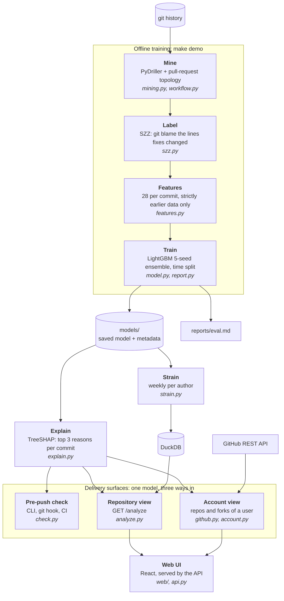
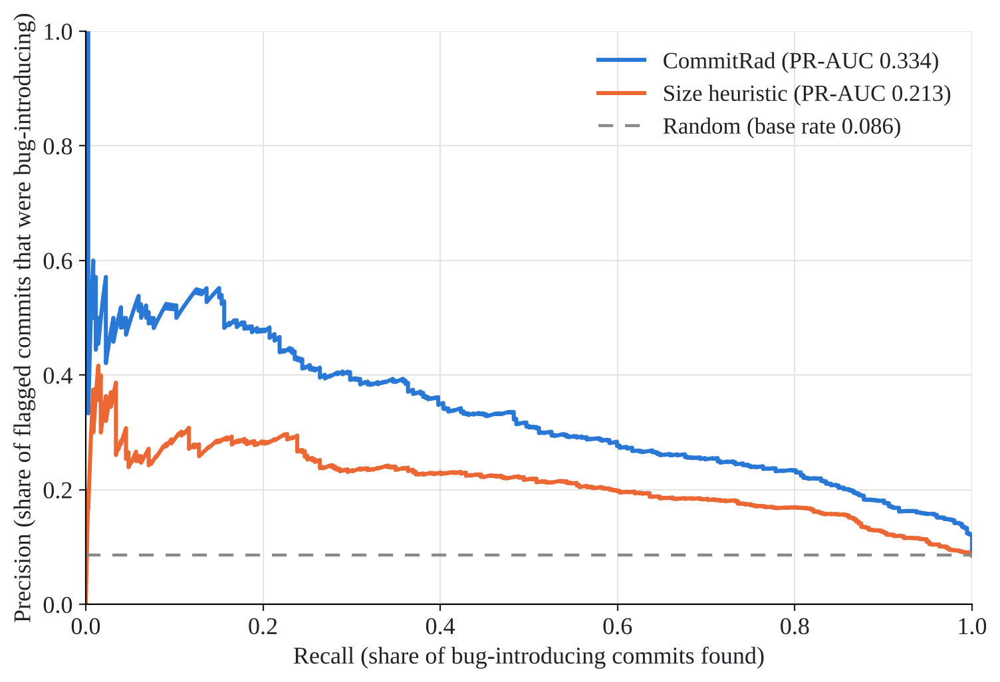
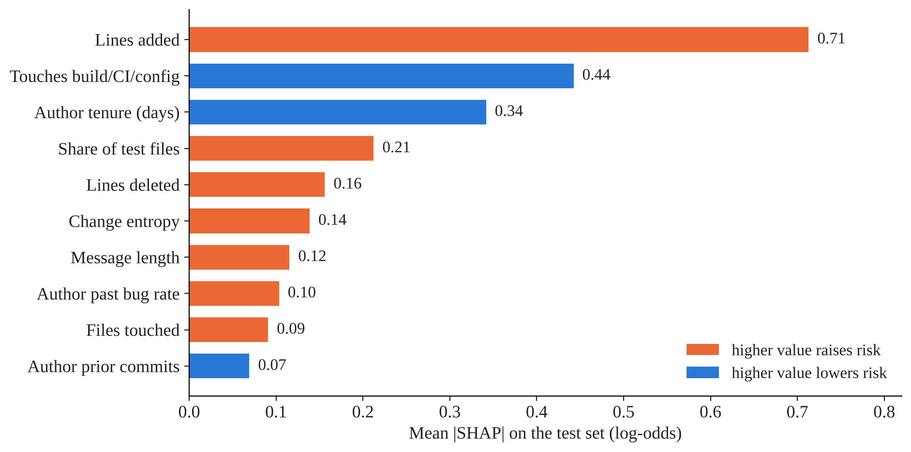

# CommitRad: how it works in detail

Architecture, method, results and comparison. For setup and an overview, see the [README](../README.md).

## Architecture

| Stage | Command | Module |
|---|---|---|
| Mine commits and how each landed (PR merge, squash `(#N)`, direct push) | `commitrad mine repos.txt` | `mining.py`, `workflow.py` |
| Label bug-introducing commits | `commitrad label repos.txt` | `szz.py` |
| Build the 28 features | `commitrad features repos.txt` | `features.py` |
| Train and evaluate | `commitrad train` | `model.py`, `report.py` |
| Weekly strain into DuckDB | `commitrad strain` | `strain.py`, `store.py` |
| Pre-push check / hook | `commitrad check`, `commitrad hook install` | `check.py` |
| API + web UI | `commitrad serve` | `api.py`, `analyze.py`, `web/` |

`make demo` rebuilds everything from scratch: mine, label, features, train, strain.

## How it works

**1. Labels (SZZ).** A fix commit is a non-merge, non-bot commit whose message mentions fix, bug,
patch or issue #N (typo, docs and style fixes excluded). The source lines it removed or changed are
traced with `git blame` to the commit that wrote them, which is labeled bug-introducing.
Whitespace-only and comment-only lines are ignored.

**2. Features (28, all leak-free).**

| Group | Features |
|---|---|
| Size and diffusion | lines added / deleted, files touched, top-level directories touched, change entropy |
| File history | prior churn of touched files (max, mean), distinct earlier authors, mean days since last change |
| How it landed | via pull request, PR size, share of test files, touches build/CI/config, revert, co-authored |
| Author | prior commits, tenure, 30-day commit rate, past bug rate (only bugs already fixed) |
| Time | local hour, weekday, night, weekend, hours since the author's previous commit |
| Message | length, word count, vagueness, sentiment |

History features use only commits with a strictly earlier timestamp. `tests/test_leakage.py`
recomputes every feature from only the data available at that moment and requires identical
values; scrambling all future data must change nothing.

**3. Model.** LightGBM gradient-boosted trees (15 leaves, learning rate 0.03, early stopping on
validation ROC-AUC), class-weighted 4.5× for the rare bug-introducing class, averaged over 5
random seeds. No random splits anywhere: oldest 70% of history trains, next 15% validates, newest
15% tests.

**4. Explanations.** Exact TreeSHAP splits each score into per-feature contributions; the three
largest become plain-language reasons such as "adds 777 lines (raises risk)".

**5. Strain.** Per author and week: off-hours share (0.30), mean commit risk (0.30), burstiness
(0.20, Kim & Jo 2016) and message negativity (0.20). Weights live in `config/strain.toml`.

## Results

Trained on **16 repositories in 4 languages**: 27,384 non-merge commits, 18.2% labeled
bug-introducing.

Training repositories

| Language | Repositories |
|---|---|
| Python | tenacity, itsdangerous, markupsafe, colorama, humanize, httpx, attrs, structlog, jinja, rich |
| JavaScript | express, commander.js, axios |
| Go | cobra, gin |
| Rust | ripgrep |

**Test period** (Nov 2023 – Nov 2026, 4,108 commits, 352 bug-introducing):

| | PR-AUC [95% CI] | ROC-AUC [95% CI] | Precision in top 10% |
|---|---|---|---|
| **CommitRad** | **0.334** [0.293, 0.385] | **0.849** [0.831, 0.867] | **0.345** |
| "Bigger diffs are riskier" | 0.213 [0.184, 0.253] | 0.764 [0.738, 0.786] | 0.241 |
| Random | 0.086 | 0.500 | 0.086 |

**Unseen repositories** (never used in training):

| Repository | Commits | PR-AUC | ROC-AUC | Lift in top 10% |
|---|---|---|---|---|
| pallets/click | 2,172 | 0.428 | 0.816 | 3.6× |
| psf/requests | 4,884 | 0.347 | 0.797 | 3.1× |
| pallets/flask | 3,832 | 0.387 | 0.829 | 4.1× |

| Precision-recall on the test period | What drives risk (mean \|SHAP\|) |
|---|---|
|  |  |

Full report: [`reports/eval.md`](../reports/eval.md).

## How it differs

| | GitHub Insights | Team metrics (LinearB, Swarmia) | Static analysis (SonarQube) | CodeScene | **CommitRad** |
|---|---|---|---|---|---|
| Predicts which change will need a fix | no | no | no | indirectly | **yes** |
| Explains each prediction | – | – | per rule | per file | **per commit (SHAP)** |
| Works before you push | no | no | yes | no | **yes** |
| Your view across all your repos and forks | counts only | org level | no | org level | **yes** |
| Runs locally, code never leaves your machine | n/a | SaaS | self-host | SaaS / on-prem | **yes** |
